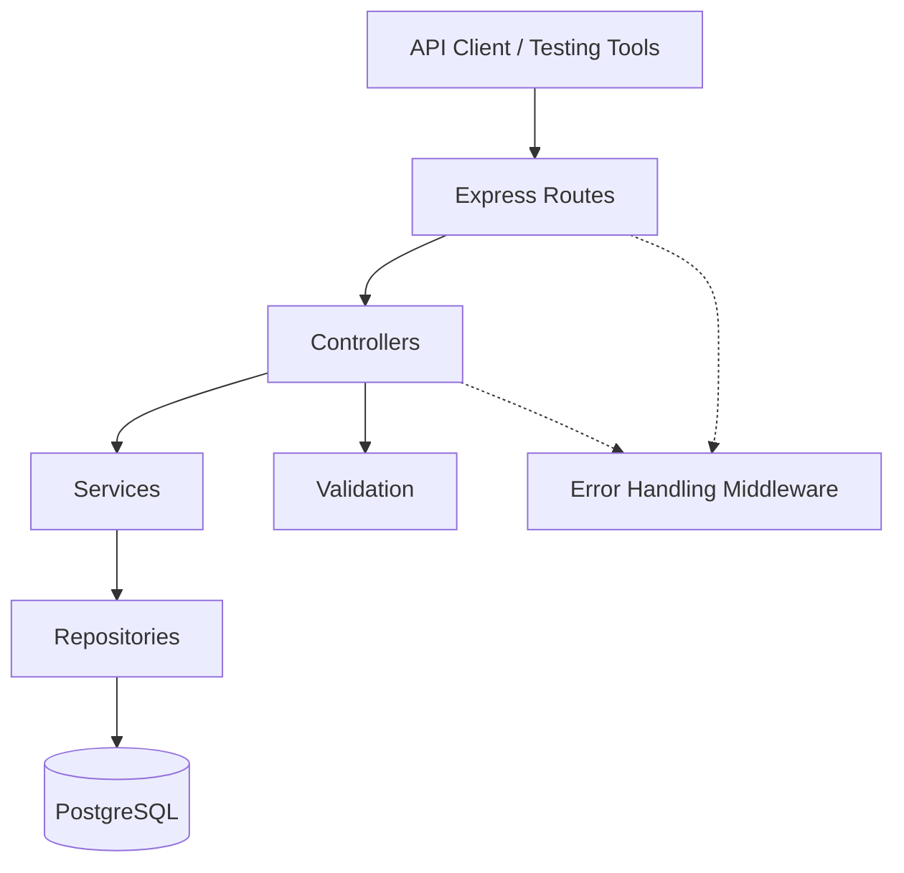

# QA Playground API


[](LICENSE)

A self-hosted REST API playground designed for QA engineers,
test automation practice, backend exploration, and performance
engineering.

Build automation frameworks, experiment with testing tools,
investigate backend behavior, and practice performance testing
in your own controllable local environment.

No dependency on external public demo APIs.
You control the environment, the data, and the testing scenarios.

> [!IMPORTANT]
> QA Playground API is designed exclusively for local
> testing, learning, and performance engineering experiments.
>
> It is not a production-ready banking application.
> Authentication and authorization are not implemented.
> Do not expose this application to the public internet
> or use it with real personal or financial data.

## Table of Contents

- [Who Is This Project For?](#who-is-this-project-for)
- [What Can You Practice?](#what-can-you-practice)
- [Features](#features)
- [Tech Stack](#tech-stack)
- [Architecture](#architecture)
- [Quick Start](#quick-start)
- [Available Endpoints](#available-endpoints)
- [Query Parameters](#query-parameters)
- [API Documentation](#api-documentation)
- [Database](#database)
- [Performance Test Data](#performance-test-data)
- [Performance Engineering Case Studies](#performance-engineering-case-studies)
- [Testing](#testing)
- [Project Status](#project-status)
- [Contributing](#contributing)
- [License](#license)

## Who Is This Project For?

- QA engineers learning API and database testing
- Test automation engineers building automation frameworks
- Performance testers experimenting with k6 or JMeter
- Backend developers exploring PostgreSQL and API behavior
- QA leads and mentors preparing practical learning environments
- Anyone looking for a reusable local system under test

## What Can You Practice?

| Testing Area | Examples |
|--------------|----------|
| API Testing | REST requests, validation, status codes, error handling |
| Test Automation | Postman, Playwright, Supertest, REST Assured |
| Database Testing | SQL queries, constraints, relationships, data integrity |
| Concurrency Testing | Parallel deposits and withdrawals, race conditions |
| Performance Testing | Load, stress, spike, and soak testing |
| Performance Engineering | Execution plans, database indexes, pagination |
| CI/CD | Automated integration tests and quality gates |

## Features

### REST API

- Users, Accounts, and Transactions modules
- Layered backend architecture
- Request validation and centralized error handling
- Filtering, sorting, and pagination
- OFFSET and cursor-based pagination
- Interactive Swagger / OpenAPI documentation

### Database

- PostgreSQL 17
- Automated database migrations and seed data
- Foreign keys and database constraints
- Transactional deposit and withdrawal processing
- Row-level locking and concurrency protection
- Composite indexes for optimized query execution

### Testing & Infrastructure

- Docker Compose setup
- Automated integration tests using Supertest
- Isolated PostgreSQL test environment
- Local and Docker-based test execution
- GitHub Actions CI pipeline

### Performance Engineering

- Configurable Small, Medium, and Large datasets
- Up to 100,000 synthetic transactions per dataset
- Optimized PostgreSQL bulk data generation
- Dataset ownership tracking
- Controlled dataset reset with dry-run support
- Documented performance engineering case studies

## Tech Stack

- Node.js 24
- Express.js
- PostgreSQL 17
- Docker & Docker Compose
- JavaScript
- Supertest
- Node.js Test Runner

## Architecture

The application follows a layered backend architecture
with separation of responsibilities.



### Architecture Overview

| Layer | Responsibility |
|-------|----------------|
| Routes | HTTP endpoint definitions |
| Controllers | Request handling and response formatting |
| Services | Business logic |
| Repositories | Database access and SQL queries |
| Validators | Input validation |
| Middleware | Cross-cutting concerns and error handling |
| Configuration | Application and database configuration |
| Database | Persistence, constraints, indexes, and transactions |

## Quick Start

The easiest way to run QA Playground API is with Docker.

No local Node.js or PostgreSQL installation is required
to start the application.

### Prerequisites

- Docker Desktop or Docker Engine
- Docker Compose v2 or later
- Git

Make sure Docker is running before proceeding.

### 1. Clone the repository

```bash
git clone https://github.com/dpopovic1990/qa-playground-api.git
cd qa-playground-api
```

### 2. Configure environment

Windows (PowerShell):

```powershell
Copy-Item .env.example .env
```

Linux / macOS:

```bash
cp .env.example .env
```

Review the environment configuration if you need to
customize database credentials or application settings.

### 3. Start the application

```bash
docker compose up -d --build
```

This command automatically:

- Starts PostgreSQL
- Waits for the database to become healthy
- Applies database migrations
- Inserts initial seed data
- Starts the REST API

Check the container status:

```bash
docker compose ps -a
```

### 4. Verify the API

Open the following URL in your browser:

http://localhost:3000/health

Expected response:

```json
{
  "status": "ok",
  "service": "qa-playground-api"
}
```

### 5. Explore the API

Open the interactive Swagger documentation:

http://localhost:3000/api-docs/

You can now explore endpoints, execute requests,
and start building your own automated tests.

### 6. Stop the application

```bash
docker compose down
```

Database data is preserved in a Docker volume
between application restarts.

### Troubleshooting

Check container status:

```bash
docker compose ps -a
```

View application logs:

```bash
docker compose logs api
```

View database initialization logs:

```bash
docker compose logs db-setup
```

## Available Endpoints

### Health

| Method | Endpoint | Description |
|--------|----------|-------------|
| GET | /health | Check API health |

### Users

| Method | Endpoint | Description |
|--------|----------|-------------|
| POST | /api/v1/users | Create a new user |
| GET | /api/v1/users | List users with pagination, filtering, and sorting |
| GET | /api/v1/users/:id | Get user by ID |

### Accounts

| Method | Endpoint | Description |
|--------|----------|-------------|
| POST | /api/v1/accounts | Create an account for an existing user |
| GET | /api/v1/accounts | List all accounts |

### Transactions

| Method | Endpoint | Description |
|--------|----------|-------------|
| POST | /api/v1/transactions | Process a deposit or withdrawal |
| GET | /api/v1/transactions | List transactions with OFFSET pagination, filtering, and sorting |
| GET | /api/v1/transactions/cursor | List transactions using cursor-based pagination |

## Query Parameters

### Users

| Parameter | Description |
|-----------|-------------|
| page | Page number |
| limit | Number of records per page |
| name | Filter users by name |
| sortBy | Column used for sorting |
| order | Sorting direction (asc or desc) |

Examples:

```http
GET /api/v1/users?page=1&limit=10
GET /api/v1/users?name=John
GET /api/v1/users?sortBy=name&order=asc
```

### Transactions — OFFSET Pagination

| Parameter | Description | Default |
|-----------|-------------|---------|
| page | Page number | 1 |
| limit | Records per page (1–100) | 20 |
| accountId | Filter by account ID | None |
| type | DEPOSIT or WITHDRAWAL | None |
| sortBy | id, amount, or created_at | created_at |
| order | asc or desc | desc |

Examples:

```http
GET /api/v1/transactions?page=1&limit=20
GET /api/v1/transactions?accountId=123
GET /api/v1/transactions?type=DEPOSIT
GET /api/v1/transactions?sortBy=amount&order=desc
GET /api/v1/transactions?page=5001&limit=20
```

### Transactions — Cursor-Based Pagination

| Parameter | Description | Default |
|-----------|-------------|---------|
| limit | Records per page (1–100) | 20 |
| cursor | Base64URL cursor from the previous response | None |

First page:

```http
GET /api/v1/transactions/cursor?limit=20
```

Next page:

```http
GET /api/v1/transactions/cursor?limit=20&cursor=<nextCursor>
```

The cursor-based endpoint uses a fixed sorting order:

- created_at DESC
- id DESC

It does not support arbitrary page navigation,
filtering, custom sorting, or total record counts.

For performance comparisons between OFFSET and cursor-based
pagination, see the Performance Engineering Case Studies.

## API Documentation

Interactive API documentation is available through Swagger UI:

http://localhost:3000/api-docs/

Swagger UI allows users to:

- Explore available API endpoints
- Review request and response schemas
- Inspect supported query parameters
- Execute API requests directly from the browser
- Review supported HTTP status codes

The OpenAPI specification is available in
[docs/openapi.yaml](docs/openapi.yaml).

## Database

The application uses PostgreSQL.

Database migrations and seed data are executed
automatically during Docker startup.

## Performance Test Data

The QA Playground API includes a configurable performance
data generator designed for load testing, stress testing,
database performance analysis, and k6 experiments.

### Dataset Profiles

| Profile | Users | Accounts | Transactions |
|---------|------:|---------:|-------------:|
| Small   | 100   | 100      | 1,000        |
| Medium  | 1,000 | 1,000    | 10,000       |
| Large   | 10,000| 10,000   | 100,000      |

Each profile generates a separate dataset.
Multiple profiles can coexist in the same database.

### Prerequisites

- Running PostgreSQL container
- Node.js 24 and npm
- Configured local `.env` file
- Installed project dependencies
- Applied database migrations

Install project dependencies before running the
performance data management scripts:

```bash
npm ci
```

Make sure the application has been started using
the Quick Start instructions and that the local
development database is available.

### Generate Performance Data

```bash
npm run data:generate:small
npm run data:generate:medium
npm run data:generate:large
```

The generator uses PostgreSQL set-based operations and
bulk inserts to efficiently create large datasets.

Features:

- Deterministic user emails and account numbers
- Explicit dataset ownership tracking
- Transactional data generation
- Protection against conflicting user and account ownership
- Duplicate prevention for existing complete datasets
- Execution time reporting

### Preview Dataset Reset

Before deleting a dataset, preview the affected records:

```bash
npm run data:reset -- small
npm run data:reset -- medium
npm run data:reset -- large
```

The default reset mode is a dry run.
No data is deleted without explicit confirmation.

### Reset Performance Data

To permanently delete a specific performance dataset:

```bash
npm run data:reset -- small --confirm
```

The reset operation removes the selected dataset's users,
accounts, transactions, and dataset metadata within a
single database transaction.

Other dataset profiles are preserved.

### Regenerate a Dataset

```bash
npm run data:reset -- small --confirm
npm run data:generate:small
```

This provides a repeatable dataset lifecycle for
performance testing experiments.

Record IDs and creation timestamps may change after
regeneration.

### Example Generation Performance

The optimized bulk generator was executed in a local
Docker-based development environment with PostgreSQL 17.

| Dataset | Users | Accounts | Transactions | Duration |
|---------|------:|---------:|-------------:|---------:|
| Large   | 10,000 | 10,000 | 100,000 | 0.87 s |

This execution generated 120,000 database records
using PostgreSQL set-based operations.

These results represent a single local execution,
not a formal performance benchmark.
Actual results depend on hardware, database configuration,
existing data, and system load.

### Important Limitations

- Performance datasets contain synthetic transaction history.
- Generated transactions do not update account balances.
- Generated data is intended primarily for read-performance testing.
- Do not use synthetic accounts for financial integrity assertions.
- Reset deletes all transactions associated with the selected
  performance accounts, including manually created transactions.
- Existing accounts containing transactions are skipped during
  generation. Reset and regenerate incomplete datasets.
- Generation and confirmed reset operations temporarily lock
  database tables against concurrent writes.
- Do not generate or reset data during active performance tests.
- These tools are intended exclusively for disposable local
  development environments.

### Performance Testing Use Cases

- API response time measurement
- Pagination performance
- Filtering and sorting performance
- Database index optimization
- Large dataset query analysis
- Load, stress, spike, and soak testing with k6

## Performance Engineering Case Studies

This project includes practical performance engineering
experiments covering database query analysis, bottleneck
identification, backend optimization, and performance testing.

| Case Study | Topic | Status |
|------------|-------|--------|
| [001](docs/performance/001-composite-index-optimization.md) | Composite Index Optimization | SQL analysis completed |
| [002](docs/performance/002-keyset-pagination.md) | Keyset Pagination | SQL analysis completed |

Each case study documents the problem, execution plans,
root cause, optimization strategy, measured results,
trade-offs, and remaining limitations.

## Testing

The project includes automated integration tests built
with Node.js Test Runner and Supertest.

### Test Coverage

The integration test suite covers:

- Health checks and error handling
- User creation and validation
- Account creation and retrieval
- Transaction processing
- Insufficient funds handling
- Transaction validation
- Concurrent deposits and withdrawals
- Database persistence and data integrity
- Filtering, sorting, and OFFSET pagination
- Cursor-based pagination
- PostgreSQL timestamp precision
- Pagination boundary conditions

### Run Tests with Docker (Recommended)

Docker-based test execution does not require a local
Node.js or PostgreSQL installation.

From the project root, run:

```bash
docker compose --profile testing run --build --rm api-tests
```

The testing workflow automatically:

1. Builds the development Docker image.
2. Starts an isolated PostgreSQL test container.
3. Applies database migrations.
4. Executes the integration test suite.

The development database is not used by Docker
integration tests.

### Run Tests Locally

Prerequisites:

- Node.js 24
- npm
- Running PostgreSQL instance
- Configured and initialized test database

Install dependencies:

```bash
npm ci
```

Configure the test environment:

Windows (PowerShell):

```powershell
Copy-Item .env.test.example .env.test
```

Linux / macOS:

```bash
cp .env.test.example .env.test
```

Review the test database configuration before
running migrations or integration tests.

The test database must be named `qa_playground_test`.

Apply test database migrations:

```bash
npm run db:migrate:test
```

Run integration tests:

```bash
npm test
```

### Continuous Integration

GitHub Actions automatically executes Docker-based
integration tests for pull requests targeting the
main branch and pushes to main.

The current CI status is displayed at the top
of this README.

## Project Status

This project is under active development.

### Implemented Features

- [x] REST API with layered backend architecture
- [x] PostgreSQL database integration
- [x] Automated database migrations and seeding
- [x] Docker Compose environment
- [x] Users API
- [x] Accounts API
- [x] Transactions API
- [x] Request validation and error handling
- [x] Database transactions and row-level locking
- [x] Concurrency and data integrity testing
- [x] OFFSET pagination, filtering, and sorting
- [x] Cursor-based pagination
- [x] Swagger / OpenAPI documentation
- [x] Automated integration tests
- [x] Isolated Docker test environment
- [x] GitHub Actions CI pipeline
- [x] Configurable performance datasets
- [x] Optimized bulk data generation
- [x] Controlled dataset reset
- [x] Performance engineering case studies

### Roadmap

- [ ] Standalone k6 performance testing framework
- [ ] Controlled HTTP performance benchmarks
- [ ] Database connection pool saturation scenarios
- [ ] Database locking performance scenarios
- [ ] Performance regression testing
- [ ] Dedicated QA practice challenges
- [ ] Additional test automation examples
- [ ] First stable public release

## Contributing

Feedback, suggestions, bug reports, and contributions
are welcome.

If you discover an issue or have an idea for improving
the QA Playground API, feel free to open a GitHub issue.

Potential contributions include:

- New API testing scenarios
- Additional integration tests
- Performance testing experiments
- Database optimization examples
- Documentation improvements
- QA practice challenges

For larger changes, please open an issue first
to discuss the proposed improvement.

## License

This project is licensed under the MIT License.

See the [LICENSE](LICENSE) file for details.